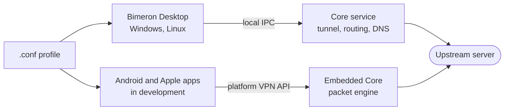

#  Bimeron Network

Bimeron Network builds open-source VPN software: one networking core and native apps on top of
it.

Bimeron turns an access profile into a system VPN or a local SOCKS5 proxy.
[Bimeron Core](https://github.com/bimeron/bimeron-core) handles the network side: tunnel setup,
routing, DNS, reconnects and cleanup. The apps manage profiles and the connection, and give each
platform a native interface.

**Start here:** [Download for Windows](https://github.com/bimeron/bimeron-desktop/releases) · [Projects](#projects) · [How it works](#how-it-works) · [Build on the core](https://github.com/bimeron/bimeron-core#integrate-the-core)

## Projects

| Project | What it is | Platforms | Status |
| --- | --- | --- | --- |
| [**Bimeron Core**](https://github.com/bimeron/bimeron-core) | Go networking engine and CLI: system VPN or local SOCKS5 proxy, rule-based routing, IPC and embedding APIs | Windows, Linux; macOS (experimental VPN); Android library (API 23+) | Pre-release |
| [**Bimeron Desktop**](https://github.com/bimeron/bimeron-desktop) | Qt 6 app: add a profile and connect in one click, without administrator rights | Windows 10 and 11 (x64, ARM64); Ubuntu 22.04+ (amd64, arm64) | Pre-release |
| [**Bimeron Android**](https://github.com/bimeron/bimeron-android) | Kotlin and Jetpack Compose app with an embedded Core | Android | In development |
| [**Bimeron Apple**](https://github.com/bimeron/bimeron-apple) | SwiftUI app for managing profiles; VPN controls come next | macOS 14+ | In development |

Each status follows the project's own documentation. Check the project README for details and
limits.

## Install

Download Bimeron Desktop from [Releases](https://github.com/bimeron/bimeron-desktop/releases):
an MSI for Windows or a DEB for Ubuntu. Each package includes a matching Core service, and the
installer sets it up.

All current versions are pre-releases. The packages are not code-signed, so Windows may warn
about an unknown publisher. Compare the file's SHA-256 with the value in the release notes
before installing.

Step-by-step instructions, upgrades and removal are in the
[Desktop README](https://github.com/bimeron/bimeron-desktop#install).

## Why Bimeron?

- **One profile everywhere:** access settings and routing rules live in a `.conf` profile that
  the CLI and every app read the same way.
- **Many upstreams:** Shadowsocks (including Shadowsocks 2022), VLESS, VMess, Trojan, Hysteria2,
  TUIC v5, AnyTLS, NaiveProxy, MASQUE, SSH, SOCKS5 and HTTP CONNECT. See
  [supported upstreams](https://github.com/bimeron/bimeron-core#supported-upstreams) for
  transports and UDP support.
- **Routing you control:** send traffic through the tunnel, directly or block it by IP range,
  domain, country or site group.
- **No elevated interface:** on Windows and Linux, a separately installed Core service owns the
  network. The app controls it over local IPC and never needs administrator rights.
- **Connection that recovers:** Core handles reconnects and cleanup; Desktop retries a dropped
  connection and explains the last error.

## How it works

- **Desktop:** Core runs as a system service and performs all privileged network operations.
  The app talks to it over a named pipe on Windows and a Unix socket on Linux.
- **Mobile and Apple:** Core is embedded as a packet engine inside the platform VPN API:
  `VpnService` on Android and NetworkExtension on Apple platforms.
- **Your own app:** use the CLI, local IPC, the Go API or a platform packet API. See
  [Integrate the core](https://github.com/bimeron/bimeron-core#integrate-the-core).

## Documentation

- [Bimeron Core documentation](https://github.com/bimeron/bimeron-core/blob/master/docs/README.md):
  profile format, routing, DNS, platform guides and integration contracts.
- [Bimeron Desktop documentation](https://github.com/bimeron/bimeron-desktop/blob/main/docs/README.md):
  features, building and release notes.

The default branches can describe changes that are not released yet. For a downloaded package,
open the README at that release's tag.

## Contributing and security

- **Contributing:** read the
  [contributing guide](https://github.com/bimeron/.github/blob/main/CONTRIBUTING.md) and agree
  on substantial changes in an issue first.
- **Security:** report vulnerabilities privately as described in the
  [security policy](https://github.com/bimeron/.github/blob/main/SECURITY.md), not in public
  issues.
- **Support:** see [getting support](https://github.com/bimeron/.github/blob/main/SUPPORT.md).
